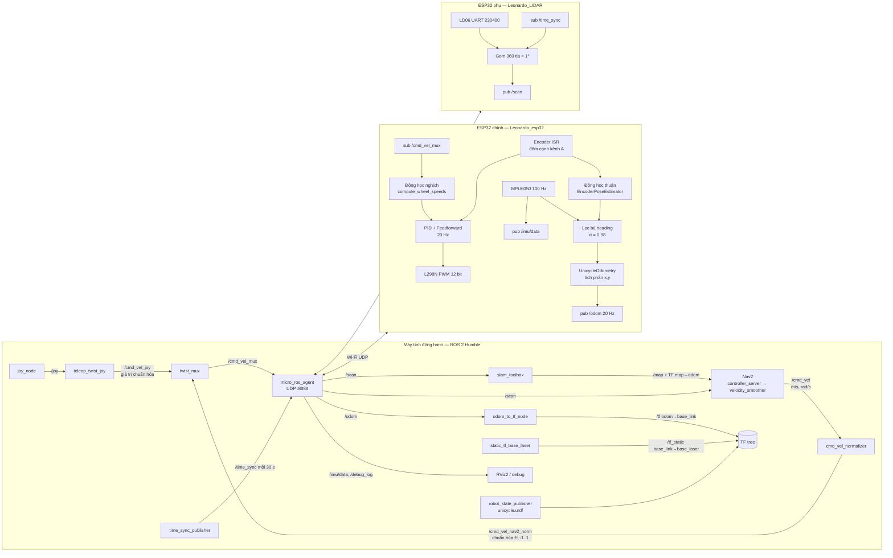

# CẨM NANG THAM KHẢO KỸ THUẬT — ROBOT LEONARDO (ESP32 + micro-ROS + ROS 2 Humble)

> Tài liệu này phân tích **mã nguồn thực tế** trong kho `Esp32_micro_Ros_mobile_robot_Leonardo`: firmware ESP32 chính (`Leonardo_esp32/`), firmware ESP32 LiDAR (`Leonardo_LIDAR/`), thư viện Arduino tự viết (`libraries_arduinoIDE/`) và workspace ROS 2 (`Leonardo/`).
> Mọi con số dưới đây được lấy từ code/YAML, kèm đường dẫn `file:dòng` để bạn tra lại. Phần nào là **nhận xét/khuyến nghị của người phân tích** (không phải của tác giả) được đánh dấu rõ bằng 🔎 hoặc ⚠️.

---

## Mục lục

0. [Tóm tắt nhanh — bảng thông số cốt lõi](#0-tóm-tắt-nhanh--bảng-thông-số-cốt-lõi)
1. [Kiến trúc & luồng dữ liệu](#1-kiến-trúc--luồng-dữ-liệu)
2. [Giải mã thuật toán điều khiển thực tế](#2-giải-mã-thuật-toán-điều-khiển-thực-tế)
3. [Cấu hình LiDAR, SLAM Toolbox và Nav2](#3-cấu-hình-lidar-slam-toolbox-và-nav2)
4. [Cẩm nang hiệu chỉnh cho xe 3 bánh (2 bánh chủ động sau + 1 bánh mắt trâu trước)](#4-cẩm-nang-hiệu-chỉnh-cho-xe-3-bánh)
5. [Phụ lục: mã mẫu, YAML mẫu, bảng ghi chép](#5-phụ-lục)

---

## 0. Tóm tắt nhanh — bảng thông số cốt lõi

| Nhóm | Thông số | Giá trị trong dự án | Nguồn |
|---|---|---|---|
| Hình học | Bán kính bánh `WHEEL_RADIUS` | **0.0346 m** (Ø 69.2 mm) | `Leonardo_esp32/Variable.hpp:47` |
| | Khoảng cách 2 bánh `WHEEL_SEPARATION` | **0.20 m** | `Variable.hpp:48` |
| Encoder | `ENCODER_PPR` | **497 × 2 = 994** cạnh/vòng trục ra | `Variable.hpp:46` |
| | Tỉ số truyền khai báo | 46.8 (chỉ dùng cho RPM trục motor, **không** dùng trong odometry) | `Variable.cpp:65-66` |
| Tốc độ | `V_MAX` (firmware) | **0.362 m/s** (≈ 100 RPM bánh) | `Variable.hpp:50` |
| | `W_MAX = 2·V_MAX/L` | **3.62 rad/s** | `Variable.hpp:51` |
| | `V_MAX`/`W_MAX` dùng để chuẩn hóa lệnh Nav2 | 0.216 m/s / 2.136 rad/s | `cmd_vel_normalizer.cpp:5-6` |
| PID | `Kp, Ki, Kd` | **24.0, 25.0, 0.0** | `Variable.cpp:75-77` |
| | Feedforward `PWM = a·RPM + b` | **a = 20.88, b = 500.85** | `Leonardo.ino:54-55` |
| | Giới hạn tích phân | ±2000 (đơn vị PWM) | `Variable.hpp:55-56` |
| | Đầu ra PWM | 0 … 4095 (12 bit, 5 kHz) | `Variable.hpp:58-59`, `Variable.cpp:21-22` |
| | Dead-zone PWM | 0 (đã tắt; hằng `DEADZONE 2048` không dùng) | `Leonardo.ino:51-53` |
| Tần số | Vòng PID | 20 Hz (50 ms) | `micro_ROS_fun.cpp:130` |
| | `/odom` | 20 Hz (50 ms) | `micro_ROS_fun.cpp:137`, `micro_ROS_fun.hpp:5` |
| | `/imu/data` | 100 Hz danh định (10 ms) | `micro_ROS_fun.cpp:144` |
| | `/scan` | ≤ ~10 Hz (phát khi đủ 360 tia) | `Leonardo_LIDAR.ino` |
| Bộ lọc | Hợp nhất heading | `θ = 0.98·θ_IMU + 0.02·θ_encoder` | `control_tools.h:107` |
| | Cập nhật bias gyro khi đứng yên | EMA, β = 0.95 | `micro_ROS_fun.cpp:224-226` |
| Nav2 (DWB) | `robot_radius` | 0.17 m | `config_param_nav2DWB.yaml:108,142` |
| | `inflation_radius` | global 0.30 m / local 0.20 m | `config_param_nav2DWB.yaml:127,161` |
| | `max_vel_x` / `max_vel_theta` | 0.195 m/s / 1.9 rad/s | `config_param_nav2DWB.yaml:42-44` |
| SLAM | `resolution` | 0.05 m/ô | `mapper_params_online_async.yaml` |

---

## 1. Kiến trúc & luồng dữ liệu

### 1.1 Phần cứng

| Khối | Linh kiện | Ghi chú từ code |
|---|---|---|
| MCU chính | ESP32 DevKit | Chạy micro-ROS qua Wi-Fi UDP, cổng 8888 |
| MCU phụ | ESP32 thứ hai | Chỉ đọc LiDAR LD06 qua `Serial2` 230400 baud (RX = GPIO16) |
| Động cơ | 2 × 25GA-370 12 V, 130 RPM, encoder Hall | Encoder trái: GPIO 34/35, phải: GPIO 16/17 |
| Driver | L298N | PWM A = GPIO32, IN1..IN4 = 33/25/26/27, PWM B = GPIO14 |
| IMU | MPU6050 (I²C, SDA 21 / SCL 22) | Dải mặc định ±250 °/s (131 LSB/(°/s)), ±2 g (16384 LSB/g) |
| Khung | 2 bánh chủ động + 1 bi cầu phía trước | Xem `Leonardo/src/leonardo/urdf/unicycle.urdf` (link `front_ball`) |
| Nguồn | NiMH 12 V + buck XL4015 | |

> 🔎 Leonardo **vốn đã là** xe 3 bánh (2 bánh chủ động + 1 bi cầu/bánh mắt trâu phía trước). Vì vậy phần lớn thuật toán có thể giữ nguyên khi chuyển sang khung của bạn — việc chính là **đo lại và hiệu chỉnh** (Mục 4).

### 1.2 Sơ đồ khối tổng thể



Dạng ASCII (khi trình xem không hiển thị Mermaid):

```
 Gamepad ─► joy_node ─► teleop_twist_joy ─/cmd_vel_joy (chuẩn hóa)─┐
                                                                    ├─► twist_mux ─/cmd_vel_mux─┐
 Nav2 ─/cmd_vel (m/s)─► cmd_vel_normalizer ─/cmd_vel_nav2_norm──────┘   (ưu tiên joy=100 > nav=10)│
                                                                                                 ▼
                                                     ┌───────── micro_ros_agent (UDP 8888) ◄──── Wi-Fi ────┐
                                                     │                                                      │
   slam_toolbox ◄── /scan ───────────────────────────┤        ESP32 chính: sub /cmd_vel_mux                  │
   Nav2 costmap ◄── /scan                            │          → IK → PID+FF (20 Hz) → L298N               │
   odom_to_tf  ◄── /odom (20 Hz) ────────────────────┤          encoder + MPU6050 → odom → pub /odom, /imu  │
                                                     │        ESP32 LiDAR: LD06 → pub /scan; sub /time_sync │
                                                     └──────────────────────────────────────────────────────┘
```

### 1.3 Bảng topic, tần số, QoS

| Topic | Kiểu | Hướng | Tần số thực tế | QoS | Nguồn |
|---|---|---|---|---|---|
| `/cmd_vel_mux` | `geometry_msgs/Twist` (**giá trị chuẩn hóa** −1..1) | PC → ESP32 | Theo nguồn đang thắng trong twist_mux: Nav2 ≈ 15 Hz (`smoothing_frequency`); gamepad: mỗi khi `/joy` thay đổi (`autorepeat_rate: 0.0`) | ESP32 subscribe **best-effort** | `micro_ROS_fun.cpp:119-123` |
| `/cmd_vel` | `Twist` (m/s, rad/s) | Nav2 → normalizer | ≈ 15 Hz (velocity_smoother) — controller chạy 20 Hz | reliable | `config_param_nav2DWB.yaml` |
| `/cmd_vel_joy` | `Twist` | teleop → twist_mux | theo sự kiện joystick | reliable | `launch_leonardo.py` |
| `/cmd_vel_nav2_norm` | `Twist` | normalizer → twist_mux | = tần số `/cmd_vel` | reliable, depth 10 | `cmd_vel_normalizer.cpp` |
| `/odom` | `nav_msgs/Odometry` | ESP32 → PC | **20 Hz** | **reliable** (`rclc_publisher_init_default`) | `micro_ROS_fun.cpp:96-101, 137` |
| `/imu/data` | `sensor_msgs/Imu` | ESP32 → PC | **100 Hz danh định** (thực tế qua Wi-Fi thường thấp hơn) | **best-effort** | `micro_ROS_fun.cpp:107-111, 144` |
| `/scan` | `sensor_msgs/LaserScan` (360 điểm) | ESP32 LiDAR → PC | ≤ ~10 Hz (phát mỗi khi đủ 360 ô góc; phụ thuộc tốc độ quay LD06) | reliable | `Leonardo_LIDAR.ino` |
| `/time_sync` | `builtin_interfaces/Time` | PC → ESP32 LiDAR | **1 lần / 30 s** | reliable | `time_sync_publisher.cpp` |
| `/tf` `odom→base_link` | TF | PC | 20 Hz (theo `/odom`) | | `odom_to_tf_node.cpp` |
| `/tf_static` `base_link→base_laser` | TF tĩnh | PC | 1 lần | | `static_tf_base_laser.cpp` |
| `/debug_log`, `/lidar/debug_log` | `std_msgs/String` | ESP32 → PC | Chỉ khi khởi tạo / sự kiện | reliable | |
| `/velocity_ctrl` | `Vector3` (ω trái/phải) | `control_teleop` | theo `/cmd_vel_joy` | best-effort | **Di sản (legacy): firmware hiện tại không subscribe topic này** |

> 🔎 **Vì sao `/scan` để reliable còn `/imu` để best-effort?** Một bản tin LaserScan 360 tia ≈ 360×4×2 B ≈ 2.9 kB, lớn hơn MTU mặc định của micro-ROS; trong micro XRCE-DDS, bản tin lớn phải đi qua luồng **reliable** để được phân mảnh (fragment). IMU nhỏ và tần số cao nên best-effort giảm tải cho Wi-Fi.

### 1.4 Lịch thời gian bên trong ESP32 chính

Tất cả chạy trong **một executor** `rclc` (đơn luồng), `loop()` gọi `rclc_executor_spin_some(..., 10 ms)` (`Leonardo.ino:77`):

| Callback | Chu kỳ | Việc làm |
|---|---|---|
| `timer_callback_IMU` | 10 ms | Đọc `getMotion6`, trừ bias, tích phân yaw (chỉ khi xe đang chạy), cập nhật bias (khi đứng yên), publish `/imu/data` |
| `timer_callback_odometry` | 50 ms | Đọc & reset bộ đếm encoder → RPM → động học thuận → hợp nhất heading → tích phân x,y → publish `/odom` |
| `timer_callback_ctrl_PID` | 50 ms | PID + feedforward cho từng bánh → `motorDriver.forward/backward` |
| `subscription_callback_control` | khi có lệnh | Động học nghịch → `w_L_ref`, `w_R_ref`, `rpm_ref_L`, `rpm_ref_R` |

Lưu ý: PID dùng `rpm_L/rpm_R` do **callback odometry** tính ra, nên vòng điều khiển thực chất có độ trễ đo tối đa 1 chu kỳ (≤ 50 ms).

### 1.5 Chuỗi lệnh vận tốc — điểm đặc biệt quan trọng

Firmware **không nhận m/s trực tiếp**. Nó coi `linear.x` và `angular.z` là giá trị **chuẩn hóa** trong [−1, 1] rồi nhân với `V_MAX`, `W_MAX` của firmware (`control_tools.h:22-48`). Do đó:

* Gamepad: `teleop_twist_joy` với `scale_linear.x = 0.8`, `scale_angular.yaw = 0.5` → tối đa 80 % `V_MAX` (0.29 m/s) và 50 % `W_MAX` (1.81 rad/s).
* Nav2: node `cmd_vel_normalizer` chia lệnh Nav2 cho `V_MAX = 0.216`, `W_MAX = 2.136`.

⚠️ **Bất nhất hệ số chuẩn hóa:** normalizer dùng 0.216 / 2.136, còn firmware nhân lại với 0.362 / 3.62. Kết quả: vận tốc thực ≈ **1.68 ×** vận tốc Nav2 ra lệnh (thẳng: 0.362/0.216 = 1.676; quay: 3.62/2.136 = 1.695). Ví dụ Nav2 ra `max_vel_x = 0.195 m/s` → xe thực chạy ≈ 0.327 m/s. Controller vẫn khép vòng qua `/odom` nên xe vẫn đi được, nhưng động học mà DWB/MPPI dự báo bị sai, dễ vọt lố và dao động. **Khi chuyển sang xe của bạn, hãy để `V_MAX`/`W_MAX` của normalizer bằng đúng giá trị trong firmware** (xem Mục 4, Bước 10).

Ví dụ số đầy đủ (giữ nguyên cấu hình gốc): Nav2 phát `v = 0.10 m/s, ω = 0.50 rad/s`

| Bước | Công thức | Kết quả |
|---|---|---|
| Normalizer | `v/0.216`, `ω/2.136` | 0.463, 0.234 |
| Firmware giải chuẩn hóa | `×0.362`, `×3.62` | v = 0.168 m/s, ω = 0.847 rad/s |
| Vận tốc dài bánh | `v ± (L/2)·ω` | v_R = 0.252 m/s, v_L = 0.083 m/s |
| RPM bánh | `v/R · 60/2π` | R: 69.6 RPM, L: 22.9 RPM |
| Feedforward | `20.88·RPM + 500.85` | R ≈ 1955 PWM, L ≈ 978 PWM (trên 4095) |

### 1.6 Cây TF và đồng bộ thời gian

```
map ──(slam_toolbox)──► odom ──(odom_to_tf_node, 20 Hz)──► base_link ──(tĩnh)──► base_laser
                                                              └─(robot_state_publisher)─► left_wheel, right_wheel, front_ball
```

* TF LiDAR (`static_tf_base_laser.cpp`): `x = 0.095 m`, `y = 0`, `z = 0.18 m`, `roll = π` (LiDAR lắp **úp ngược**), `yaw = −π/2`.
* **Tem thời gian `/odom` và `/imu/data` lấy từ `millis()` của ESP32** (thời gian kể từ lúc bật nguồn, không phải giờ ROS) — `micro_ROS_fun.cpp:246-248`. Tác giả "né" vấn đề bằng cách `odom_to_tf_node` **đóng dấu lại TF bằng đồng hồ PC** (`this->get_clock()->now()`). Hệ quả: nếu bạn đưa `/odom` hoặc `/imu/data` vào `robot_localization` (EKF) thì sẽ lỗi thời gian.
* LiDAR thì có đồng bộ: PC gửi `/time_sync` mỗi 30 s, ESP32 LiDAR tính `offset = t_PC − rmw_uros_epoch_millis()` và cộng vào tem của `/scan`. Firmware LiDAR **chờ** bản tin `/time_sync` đầu tiên rồi mới phát scan — nên sau khi khởi động có thể phải đợi tới 30 s.

---

## 2. Giải mã thuật toán điều khiển thực tế

### 2.1 Ký hiệu

| Ký hiệu | Ý nghĩa | Giá trị |
|---|---|---|
| `R` | bán kính bánh | 0.0346 m |
| `L` | khoảng cách tâm 2 bánh | 0.20 m |
| `N` | số cạnh xung đếm được trên 1 vòng trục ra | 994 |
| `Δt_o` | chu kỳ odometry | 0.05 s |
| `Δt_i` | chu kỳ IMU | 0.01 s |

### 2.2 Động học nghịch (lệnh `v, ω` → tốc độ từng bánh) — `control_tools.h:22-48`

```
// 1) Chống quay quá nhanh khi đứng yên
nếu |v_norm| < 0.01  thì  w_norm ← 0.8 · w_norm

// 2) Giải chuẩn hóa
v = clamp(v_norm, −1, 1) · V_MAX            (V_MAX = 0.362 m/s)
ω = clamp(w_norm, −1, 1) · W_MAX            (W_MAX = 2·V_MAX/L = 3.62 rad/s)

// 3) Vận tốc dài của mỗi bánh
v_R = v + (L/2)·ω
v_L = v − (L/2)·ω

// 4) Bão hòa có giữ tỉ lệ (giữ nguyên độ cong quỹ đạo)
s = max(|v_R|, |v_L|);  nếu s > V_MAX:  v_R ← v_R·V_MAX/s,  v_L ← v_L·V_MAX/s

// 5) Đổi sang vận tốc góc bánh & RPM
ω_R = v_R / R ,  ω_L = v_L / R                       [rad/s]
RPM = ω · 60 / (2π)                                  (computeRPM, control_tools.h:64-69)
```

Ý nghĩa thiết kế:
* Bước 4 là **"desaturation" giữ độ cong**: thay vì cắt riêng từng bánh (làm xe lệch hướng), tác giả co cả hai bánh theo cùng tỉ lệ, nên bán kính quay `v/ω` không đổi.
* Hệ số 0.8 khi quay tại chỗ giúp giảm trượt của bi cầu/bánh mắt trâu và giảm nhiễu IMU khi xoay nhanh.

### 2.3 Động học thuận (encoder → `v, ω`) — `EncoderPoseEstimator.cpp:25-44`

```
v_L = RPM_L · 2π/60 · R
v_R = RPM_R · 2π/60 · R
v   = (v_R + v_L) / 2
ω   = (v_R − v_L) / L          (ω > 0: quay trái / ngược chiều kim đồng hồ)
θ_enc ← wrap(θ_enc + ω·Δt_o)   (bọc về [−π, π])
```

### 2.4 Đổi xung encoder → RPM — `encoder.cpp`

```cpp
// ISR (attachInterrupt trên kênh A, chế độ CHANGE):
if (digitalRead(A) == digitalRead(B))  tick++;  else  tick--;

// Mỗi 50 ms (getOutputRPMandReset(50)):
RPM = tick · 60000 / (N · dt_ms) ;   tick = 0
```

* Chỉ ngắt trên **kênh A, cả hai cạnh** → giải mã **×2** (vì vậy `ENCODER_PPR = 497 × 2`). Kênh B chỉ dùng để xác định chiều.
* Độ phân giải tại 20 Hz: **1 xung = 1.207 RPM = 4.37 mm/s**; 1 xung tương ứng **0.219 mm** quãng đường lăn.
* `gearRatio = 46.8` chỉ dùng trong `getMotorRPMandReset` (không được gọi). Như vậy 497 là số xung kênh A trên **1 vòng trục ra hộp số** (giá trị đã gộp tỉ số truyền).

### 2.5 IMU: quy đổi, bias, tích phân yaw — `IMU_tools.h`, `micro_ROS_fun.cpp:196-236`

```
Khởi động: bias_z = trung bình 500 mẫu gz_raw, cách nhau 5 ms (≈ 2.5 s, xe phải đứng yên)

Mỗi 10 ms:
  gz [rad/s] = (gz_raw − bias_z) / 131 · π/180
  nếu xe đang chạy (v ≠ 0 hoặc ω ≠ 0 theo odometry):
        Θ_IMU ← wrap(Θ_IMU + gz · 0.01)
  ngược lại (đứng yên):
        bias_z ← 0.95·bias_z + 0.05·gz_raw          (EMA, hằng số thời gian ≈ 0.2 s)
```

Đây là kỹ thuật **ZUPT (Zero-velocity update) cho gyro**: chỉ tích phân khi bánh xe đang quay → yaw không trôi khi xe đứng; đồng thời dùng thời gian đứng yên để bám theo bias thay đổi theo nhiệt độ.

Bản tin `/imu/data` gửi **giá trị thô chưa trừ bias**, `orientation_covariance[0] = −1` (báo "không cung cấp orientation"), phương sai gyro `1e-4 (rad/s)²`, gia tốc `4e-2 (m/s²)²`. Frame `imu_link` không có trong URDF/TF.

### 2.6 Hợp nhất heading (lọc bù) — `control_tools.h:106-109`, `micro_ROS_fun.cpp:250`

```
θ = 0.98 · Θ_IMU + 0.02 · θ_enc
```

* Thực chất đây là **trung bình có trọng số của hai góc tuyệt đối** (cả hai đều do tích phân), không phải bộ lọc bù kinh điển (HPF gyro + LPF tham chiếu tuyệt đối). Heading thu được ≈ 98 % từ gyro — hợp lý vì với xe bi cầu, encoder sai yaw nhiều do trượt bánh khi quay.
* Biến `alpha_filter_c = 0.5` trong `Variable.cpp:94` **không được dùng**.
* ⚠️ Phép trung bình trực tiếp **sai khi hai góc nằm hai bên ±π** (ví dụ `Θ_IMU = −3.13`, `θ_enc = +3.13` → ra −3.00 thay vì ≈ ±π). Xem cách sửa ở Phụ lục 5.3.
* Dòng `// float theta = Enc_est.getThetaEncoder();` (`micro_ROS_fun.cpp:251`) là "công tắc" tác giả để lại để chạy **odometry chỉ bằng encoder** — rất hữu ích khi hiệu chỉnh `L` (Mục 4, Bước 6).

### 2.7 Tích phân odometry & covariance — `UnicycleOdometry.cpp`, `micro_ROS_fun.cpp:240-277`

```
x ← x + v · cos(θ) · Δt_o
y ← y + v · sin(θ) · Δt_o
quaternion = (0, 0, sin(θ/2), cos(θ/2))
```

* Tích phân Euler bậc 1, `Δt_o` **cố định 0.05 s** (không đo thời gian thực). Nếu executor bị trễ (Wi-Fi nghẽn), sai số quãng đường tăng — xem khuyến nghị đo `micros()` ở Phụ lục 5.4.
* `twist.linear.z` bị tác giả dùng làm **kênh debug: chứa θ tính bằng độ** (`micro_ROS_fun.cpp:266`). Nav2 bỏ qua trường này, nhưng đừng để EKF đọc nó.

Covariance khai báo (`micro_ROS_fun.cpp:36-52`):

| Phần tử | Phương sai | Độ lệch chuẩn tương đương |
|---|---|---|
| pose x, y | 5e-5 m² | ≈ 7 mm |
| pose yaw | 1.95e-2 rad² | ≈ 0.14 rad ≈ 8° |
| twist vx, vy | 2.5e-5 (m/s)² | 5 mm/s |
| twist yaw-rate | 9e-4 (rad/s)² | 0.03 rad/s |
| z, roll, pitch | 1e6 | "không tin cậy" |

### 2.8 Bộ điều khiển PID + feedforward — `libraries_arduinoIDE/PID/PID.cpp`, `micro_ROS_fun.cpp:286-316`

**Thông số thực tế:**

```cpp
float kp = 24.0f;  float ki = 25.0f;  float kd = 0.0f;            // Variable.cpp:75-77
PID pid_L(kp, ki, kd, PID_DT/1000 /*=0.1 s*/, -2000, 2000, 0, 4095);
pid_L.setDeadZone(0);
pid_L.setFeedforwardParams(20.88f, 500.85f);   // PWM_ff = 20.88·RPM_ref + 500.85
pid_L.enableFeedforward(1);                    // (pid_R giống hệt)
```

**Cấu trúc một bước tính** (`PID::compute`):

```
e      = |RPM_ref| − |RPM_đo|                           // làm việc trên trị tuyệt đối
P      = Kp · e
D      = −Kd · lọcLPF( d(RPM_đo)/dt , α = 0.1 )          // đạo hàm trên phép đo, có lọc (hiện Kd = 0)
I_tạm  = I + Ki · e · dt
nếu  outMin < P + I_tạm + D < outMax:  I ← I_tạm         // chống bão hòa tích phân kiểu "conditional integration"
I      = clamp(I, −2000, 2000)
u      = round(P + I + D  +  (a·RPM_ref + b))            // + feedforward
u      = u ± deadZone (=0)
PWM    = clamp(u, 0, 4095)
```

**Xử lý chiều quay** (`timer_callback_ctrl_PID`): PID tính trên độ lớn, chiều do **dấu của lệnh** quyết định:

```
nếu |ω_ref| > 0.01 rad/s:  PWM = |PID(|RPM_ref|, |RPM_đo|)|,  ω_ref > 0 ? forward : backward
ngược lại:                  PWM = 0 (thả trôi, không phanh)
```

Đây chính là nội dung của commit "HOTFIX negative velocity": bộ PID chỉ xuất 0…4095 nên tác giả đưa mọi thứ về trị tuyệt đối và tách chiều ra ngoài.

**Ý nghĩa của từng thành phần:**

* **Feedforward tuyến tính** gánh phần lớn tín hiệu: ở `V_MAX` (≈ 99.9 RPM) FF ≈ 2587 PWM (63 % thang đo). Hệ số `b = 500.85` chính là **ngưỡng PWM thắng ma sát tĩnh** của động cơ, `a = 20.88 PWM/RPM` là độ dốc đặc tính tĩnh. PID chỉ còn sửa phần sai lệch nhỏ quanh đó → đáp ứng nhanh mà Kp không cần lớn.
* **Kd = 0**: hợp lý vì tín hiệu RPM bị lượng tử hóa thô (1.2 RPM/xung) — đạo hàm sẽ chỉ khuếch đại nhiễu lượng tử.
* ⚠️ **Ki hiệu dụng gấp đôi khai báo**: PID được khởi tạo với `dt = PID_DT = 100 ms` (`Variable.hpp:53`) nhưng timer gọi mỗi **50 ms**. Mỗi lần gọi cộng `Ki·e·0.1`, tức 20 lần/s → **Ki hiệu dụng ≈ 50 PWM/(RPM·s)**. Nếu bạn sửa `PID_DT` thành 50 thì phải nhân đôi `ki` để giữ hành vi cũ.
* ⚠️ Điều kiện chống bão hòa chỉ xét `P + I + D` (không tính FF) so với [0, 4095], nên khi tổng có FF đã bão hòa mà phần PID chưa, tích phân vẫn có thể tích lũy (bị chặn bởi ±2000).
* PWM tối thiểu là 0 → không thể phanh chủ động; khi lệnh = 0 động cơ thả trôi theo quán tính.

### 2.9 Cách tác giả xử lý nhiễu xung encoder khi chạy thực tế

Trong code **không có bộ lọc số riêng cho xung encoder** (không debounce, không lọc trung bình trượt, không lọc Kalman). Sự "chống nhiễu" đến từ các lớp sau:

| # | Cơ chế | Vị trí | Tác dụng thực tế |
|---|---|---|---|
| 1 | Giải mã cầu phương (quadrature) A/B: `A==B → +1, ngược lại −1` | `encoder.cpp:17-27` | Rung/dội cạnh qua lại tự triệt tiêu (+1 −1 = 0) thay vì cộng dồn như encoder 1 kênh |
| 2 | Đếm theo cửa sổ 50 ms rồi reset | `encoder.cpp:54-60` | Tương đương lọc trung bình 50 ms (lọc thông thấp dạng sinc) — đổi lại độ trễ & lượng tử 1.2 RPM |
| 3 | PID trên trị tuyệt đối + chiều theo lệnh | `micro_ROS_fun.cpp:293-315` | Nhiễu đổi dấu quanh 0 RPM không làm bộ điều khiển đảo chiều động cơ |
| 4 | Ngưỡng lệnh `|ω_ref| < 0.01 rad/s → PWM = 0` | `micro_ROS_fun.cpp:291` | Không "rung" động cơ khi lệnh gần 0 |
| 5 | Kd = 0 (và nếu bật D thì có LPF α = 0.1 trên phép đo) | `PID.cpp:24-29` | Không khuếch đại nhiễu lượng tử |
| 6 | Feedforward chiếm phần lớn PWM | `Leonardo.ino:54-55` | Kp nhỏ → nhiễu đo ít ảnh hưởng tới PWM |
| 7 | Heading 98 % từ gyro | `control_tools.h:107` | Trượt bánh/nhiễu encoder ít ảnh hưởng tới yaw của odometry |
| 8 | ZUPT gyro + cập nhật bias khi đứng yên | `micro_ROS_fun.cpp:213-227` | Yaw không trôi khi xe đứng |

⚠️ Các điểm yếu về phần cứng/đọc encoder cần biết khi làm xe mới:
* **GPIO 34/35 (encoder trái) là chân chỉ-vào, không có điện trở kéo lên nội**, và code dùng `pinMode(INPUT)` → cần **điện trở kéo lên ngoài 4.7–10 kΩ lên 3.3 V** (nhiều module encoder Hall có sẵn; nếu không, nhiễu sẽ sinh xung ma).
* Đọc/reset bộ đếm dùng `noInterrupts()/interrupts()` — trên core Arduino-ESP32 đây không phải cơ chế khóa đáng tin cậy giữa ISR và task (và ESP32 có 2 nhân). Code đã khai báo sẵn `encoderMux_L/R` (`Variable.cpp:63-64`) nhưng không dùng. Nên thay bằng `portENTER_CRITICAL` (Phụ lục 5.2).
* Có thể bật thêm **bộ lọc glitch phần cứng** nếu chuyển sang ngoại vi PCNT của ESP32 (có `filter` theo chu kỳ APB) — giải pháp tốt nhất cho tốc độ cao.

### 2.10 Bảng các điểm cần lưu ý trong mã (🔎 nhận xét của người phân tích)

| Mức | Vấn đề | Vị trí | Hậu quả / Cách xử lý |
|---|---|---|---|
| 🔴 Cao | Bộ đệm subscription là `control_msg` kiểu **`Vector3` (24 B)** nhưng topic là **`Twist` (48 B)** | `micro_ROS_fun.cpp:161`, `Variable.cpp:49` | Ghi tràn bộ nhớ sang biến kế bên. Sửa: dùng `&cmd_vel_msg` (đã khai báo sẵn kiểu `Twist`) |
| 🔴 Cao | Không có **watchdog lệnh**: mất Wi-Fi thì ESP32 giữ lệnh cuối cùng, xe chạy mãi | `micro_ROS_fun.cpp` | Thêm timeout 0.5 s (Phụ lục 5.1) |
| 🔴 Cao | Hệ số chuẩn hóa Nav2 (0.216/2.136) ≠ firmware (0.362/3.62) | `cmd_vel_normalizer.cpp:5-6` | Tốc độ thực ≈ 1.68× lệnh Nav2. Đồng bộ lại |
| 🟠 TB | Ki hiệu dụng gấp đôi do `PID_DT = 100 ms` nhưng timer 50 ms | `Variable.hpp:53`, `micro_ROS_fun.cpp:130` | Đặt `PID_DT 50.0f` và chỉnh lại Ki |
| 🟠 TB | Trung bình góc không xử lý ±π | `control_tools.h:106-109` | Dùng công thức theo hiệu góc (Phụ lục 5.3) |
| 🟠 TB | Tem thời gian `/odom`, `/imu` từ `millis()` | `micro_ROS_fun.cpp:246-248, 404-406` | Dùng `rmw_uros_sync_session()` + `rmw_uros_epoch_nanos()` (Phụ lục 5.5) |
| 🟠 TB | `Δt` odometry/IMU cố định | `micro_ROS_fun.cpp:219, 244` | Đo bằng `micros()` |
| 🟡 Thấp | Executor khai báo 6 handle, dùng 4 | `micro_ROS_fun.cpp:152` | Vô hại |
| 🟡 Thấp | `twist.linear.z` = θ (độ) để debug | `micro_ROS_fun.cpp:266` | Xóa khi đưa vào EKF |
| 🟡 Thấp | URDF đặt bánh ở y = ±0.085 (vết 0.17 m) trong khi firmware `L = 0.20` | `unicycle.urdf` | URDF chỉ để hiển thị; `L` hiệu dụng thường khác vết bánh đo bằng thước — phải hiệu chỉnh |
| 🔐 Bảo mật | SSID/mật khẩu Wi-Fi và IP agent ghi cứng & đã commit công khai | `Variable.cpp:55-57`, `Leonardo_LIDAR.ino` | Đổi mật khẩu mạng đó; chuyển thông tin vào file `secrets.h` đưa vào `.gitignore` |
| ⚙️ Môi trường | Thư viện `MotorDriver` dùng `ledcSetup/ledcAttachPin` | `MotorDriver.cpp` | Chỉ biên dịch với **core Arduino-ESP32 2.0.x** (core 3.x đã đổi API). `micro_ros_arduino` cho Humble cũng nhắm core 2.0.x |
| ⚙️ Launch | `twist_mux` nhận `parameters=[{'…yaml'}]` (một *set* Python) và đường dẫn tuyệt đối `/home/genesis/...` | `launch_leonardo.py:88-90` | Nên sửa thành `parameters=['<đường dẫn>/config_param_cmd_vel_mux.yaml']` |
| ⚙️ Launch | Agent chạy `udp6` trong launch, README hướng dẫn `udp4`; ESP32 cấu hình agent bằng IPv4 | `launch_leonardo.py:126` | Nếu ESP32 không kết nối được, dùng `udp4` |

---

## 3. Cấu hình LiDAR, SLAM Toolbox và Nav2

### 3.1 LiDAR LD06 (firmware ESP32 phụ)

| Trường `LaserScan` | Giá trị | Giải thích |
|---|---|---|
| `frame_id` | `base_laser` | Phải trùng TF tĩnh `base_link → base_laser` |
| `angle_min / angle_max` | 0 / 2π | Quét 360° |
| `angle_increment` | 2π/360 (1°) | Firmware **gom về 360 ô góc nguyên** (`round(angle) % 360`), mỗi ô lấy điểm đến đầu tiên |
| `scan_time` | 0.1 s | Giả định 10 Hz |
| `time_increment` | 0.1/360 | |
| `range_min / range_max` | 0.02 / 12.0 m | Ngoài dải → `+inf` (đúng quy ước "không có vật cản") |
| `intensities` | độ tin cậy LD06 (0–255) | |
| Tần số phát | Khi đủ 360 ô | ⇒ ≤ tần số quay của LD06; nếu thiếu ô góc nào, phải đợi thêm vòng |

TF lắp LiDAR (`static_tf_base_laser.cpp`): `x = +0.095 m` (trước tâm trục bánh), `z = 0.18 m`, `roll = π` (lắp úp), `yaw = −π/2`. LD06 đo góc **theo chiều kim đồng hồ** nhìn từ trên xuống, trong khi ROS dùng **ngược chiều kim đồng hồ** — cặp `roll = π` + `yaw` chính là cách "lật" về đúng quy ước.

> 🔎 Theo quy ước LaserScan, `angle_max = angle_min + (n−1)·angle_increment`. Với 360 điểm, giá trị chuẩn là `2π − 2π/360`. Nếu slam_toolbox báo lỗi kiểu *"LaserRangeScan contains 360 range readings, expected 361"*, hãy sửa `angle_max` như vậy.

### 3.2 `slam_toolbox` — `Leonardo/src/mio_slam_toolbox/config/mapper_params_online_async.yaml`

Chạy chế độ **online async** (`online_async_launch.py`): xử lý scan mới nhất có thể, bỏ qua scan nếu chưa kịp → phù hợp PC yếu/Wi-Fi.

| Tham số | Giá trị | Ý nghĩa | 🔎 Ghi chú (Humble) |
|---|---|---|---|
| `odom_frame / map_frame / base_frame` | odom / map / base_link | Khung tọa độ | ✅ hợp lệ |
| `scan_topic` | /scan | | ✅ |
| `mode` | mapping | Vẽ bản đồ mới (đổi `localization` khi đã có bản đồ) | ✅ |
| `resolution` | 0.05 | Mỗi ô 5 cm. Robot nhỏ, LiDAR 1°: ở 3 m khoảng cách giữa 2 tia ≈ 5.2 cm ⇒ 0.05 là khớp | ✅ |
| `max_laser_range` | 10.0 | Chỉ dùng tia ≤ 10 m để dựng bản đồ (LD06 danh định 12 m, phần xa nhiễu) | ✅ |
| `min_laser_range` | 0.2 | Bỏ tia < 20 cm (thường là thân xe/dây) | ✅ ở bản mới; bản cũ có thể bỏ qua |
| `scan_buffer_size` | 2 | Số scan giữ trong chuỗi so khớp cục bộ. Mặc định 10; 2 → nhẹ CPU nhưng so khớp kém bền | ✅ |
| `solver_plugin` | CeresSolver | Bộ tối ưu đồ thị tư thế | ✅ |
| `ceres_linear_solver` | SPARSE_NORMAL_CHOLESKY | | ✅ |
| `map_update_inerval` | 1.0 | **Gõ sai chính tả** (đúng là `map_update_interval`) ⇒ bị bỏ qua, dùng mặc định 5 s | ⚠️ |
| `odom_rate`, `scan_period`, `ceres_max_num_iterations` | 20 / 0.13 / 5 | Không phải tham số của slam_toolbox | ⚠️ bị bỏ qua |
| `loop_closure_detection`, `loop_closure_search_radius`, `loop_closure_search_interval`, `min_constraint_score` | true / 2.0 / 15 / 0.55 | Ý định: bật đóng vòng, bán kính tìm 2 m. Tên đúng: `do_loop_closing`, `loop_search_maximum_distance`, `loop_match_minimum_response_fine`… | ⚠️ bị bỏ qua (mặc định: đóng vòng bật, bán kính 3 m) |
| `max_submaps_to_keep`, `pose_graph.*`, `publish_period_sec`, `publish_frame_projected_map`, `always_send_full_map` | | Tên kiểu Cartographer | ⚠️ bị bỏ qua |

> 🔎 Node ROS 2 chỉ nhận tham số đã khai báo; tên sai sẽ **lặng lẽ bị bỏ qua**. Kiểm tra bằng: `ros2 param list /slam_toolbox` và `ros2 param get /slam_toolbox map_update_interval`. Bản YAML đã sửa tên cho xe của bạn nằm ở Phụ lục 5.7.

Các tham số "thật" quan trọng nên điều chỉnh (giá trị mặc định theo file mẫu của slam_toolbox):

| Tham số | Mặc định | Ý nghĩa |
|---|---|---|
| `map_update_interval` | 5.0 s | **Tần số cập nhật bản đồ** `/map` (1/5 Hz). Đặt 1–2 s để xem bản đồ mượt hơn khi vẽ |
| `transform_publish_period` | 0.02 s | Chu kỳ phát TF `map→odom` (50 Hz) |
| `minimum_travel_distance` | 0.5 m | Phải đi được ≥ khoảng này mới thêm scan vào đồ thị |
| `minimum_travel_heading` | 0.5 rad | Hoặc quay ≥ góc này |
| `minimum_time_interval` | 0.5 s | Khoảng thời gian tối thiểu giữa 2 scan được xử lý |
| `throttle_scans` | 1 | Xử lý 1/N scan |
| `transform_timeout` | 0.2 s | Chờ TF tối đa — với Wi-Fi nên 0.3–0.5 |
| `do_loop_closing` | true | Bật đóng vòng |
| `loop_search_maximum_distance` | 3.0 m | Bán kính tìm ứng viên đóng vòng |

### 3.3 Nav2 — file khuyến nghị của tác giả: `Leonardo/config/config_param_nav2DWB.yaml`

Tiêu đề file ghi rõ mục tiêu: *"robot vi sai trong nhà – hành lang tối thiểu 50 cm"*.

#### a) Kích thước an toàn & costmap

| Tham số | Global | Local | Ý nghĩa & phân tích |
|---|---|---|---|
| `robot_radius` | 0.17 | 0.17 | Robot được coi là **hình tròn bán kính 17 cm quanh `base_link`** (tâm trục bánh). Theo URDF, thân hộp 0.25×0.17 m đặt lệch về trước 4 cm ⇒ bán kính ngoại tiếp ≈ 0.186 m. Tác giả chọn hơi nhỏ hơn để lọt hành lang 50 cm, phần thiếu được bù bằng inflation |
| `inflation_radius` | **0.30** | **0.20** | Khoảng cách tính từ mép vật cản mà chi phí còn > 0. Global rộng → planner ưu tiên đi giữa hành lang; local hẹp → controller không bị "kẹt" ở chỗ hẹp |
| `cost_scaling_factor` | 1.1 | 2.0 | Độ dốc suy giảm chi phí (xem công thức dưới) |
| `resolution` | 0.07 | 0.07 | Ô costmap 7 cm (thô hơn bản đồ SLAM 5 cm → nhẹ CPU) |
| `update_frequency` | 6 Hz | 12 Hz | Tần số cập nhật costmap |
| `publish_frequency` | 3 Hz | 6 Hz | Tần số phát costmap ra RViz |
| `transform_tolerance` | 0.3 s | 0.3 s | Chấp nhận TF trễ 0.3 s (cần cho Wi-Fi) |
| `rolling_window` / kích thước | — | true, 3×3 m | Local costmap trượt theo robot |
| `obstacle_max_range` | 3.0 m | 2.5 m | Chỉ **đánh dấu** vật cản trong bán kính này |
| `raytrace_max_range` | 3.5 m | 3.0 m | **Xóa** ô trống dọc tia tới khoảng này (luôn > obstacle_max_range để xóa được vật cản cũ) |
| `obstacle_min_range` / `raytrace_min_range` | 0.1 | 0.1 | Bỏ tia rất gần |

Công thức chi phí của Nav2 InflationLayer:

```
cost(d) = 252 · exp( −cost_scaling_factor · (d − r_inscribed) ) ,   r_inscribed ≤ d ≤ inflation_radius
(d < r_inscribed → 253 "INSCRIBED", tức chắc chắn va chạm; d > inflation_radius → 0)
```

Áp vào cấu hình gốc (r = 0.17):

| d (m) | Global (k = 1.1) | Local (k = 2.0) |
|---|---|---|
| 0.17 | 252 | 252 |
| 0.19 | 246 | 242 |
| 0.20 | 245 | 237 (biên) |
| 0.30 | 218 (biên) | 0 |

🔎 Nhận xét: với `k` nhỏ như vậy, chi phí gần như **phẳng và rất cao** trong cả dải inflation rồi rơi về 0 ⇒ inflation hoạt động như "vật cản dày thêm" chứ không tạo gradient đẩy robot ra giữa đường. Nếu muốn gradient rõ trong hành lang hẹp, tăng `k` (≈ 5–10) hoặc mở rộng `inflation_radius`.

⚠️ Các điểm cần kiểm tra trong file DWB:
* `sensor_frame: laser_frame` — frame này **không tồn tại** trong cây TF (LiDAR là `base_laser`). Trong Nav2, khi `sensor_frame` khác rỗng nó được dùng để tra TF gốc tia; nếu tra không được, lớp vật cản có thể bỏ quan sát. Đặt `sensor_frame: base_laser` hoặc để `""` (dùng `frame_id` của bản tin).
* **Global costmap không có `static_layer`** (file MPPI thì có) ⇒ bản đồ SLAM không được dùng để lập kế hoạch toàn cục; costmap toàn cục chỉ dựng từ LiDAR với kích thước mặc định. Nên thêm `static_layer`.
* File MPPI đặt `inflation_radius: 0.10` **nhỏ hơn** `robot_radius 0.17` ⇒ không còn vùng inflation nào ngoài vùng va chạm (Nav2 sẽ cảnh báo).

#### b) Controller DWB và tốc độ

| Tham số | Giá trị | Ý nghĩa |
|---|---|---|
| `controller_frequency` | 20 Hz | Tần số tính lệnh vận tốc |
| `min_x_velocity_threshold` | 0.1 m/s | Vận tốc odometry < 0.1 bị coi là 0 khi đưa cho controller |
| `min_theta_velocity_threshold` | 0.2 rad/s | Tương tự cho quay |
| `max_vel_x` / `min_vel_x` | 0.195 / 0.0 | Tối đa 0.195 m/s (giảm 10 % từ 0.216); **không cho lùi** |
| `max_vel_theta` | 1.9 rad/s | |
| `max_speed_xy` / `min_speed_xy` | 0.195 / 0.0 | |
| `acc_lim_x` / `decel_lim_x` | 0.18 / −0.25 m/s² | Giới hạn gia/giảm tốc |
| `acc_lim_theta` / `decel_lim_theta` | 1.0 / −1.5 rad/s² | |
| `sim_time` | 1.5 s | Mô phỏng mỗi quỹ đạo ứng viên 1.5 s phía trước (≈ 0.3 m ở 0.195 m/s) |
| `vx_samples` / `vtheta_samples` | 10 / 20 | Số mẫu vận tốc trong cửa sổ động |
| `critics` | RotateToGoal, Oscillation, BaseObstacle, GoalAlign, PathAlign, PathDist, GoalDist | |
| `BaseObstacle.scale` | 0.02 | Trọng số tránh vật cản — **rất nhỏ** so với bám đường (32) ⇒ xe bám path rất sát, dựa vào planner để tránh vật cản |
| `PathAlign / PathDist` | 32 / 32 | Bám thẳng hàng & bám sát đường |
| `GoalAlign / GoalDist` | 24 / 24 | Hướng về đích |
| `RotateToGoal.scale` | 32 | Xoay về đúng hướng ở đích |
| `Oscillation.scale` | 0.0 | Tắt phạt dao động |
| `xy_goal_tolerance` / `yaw_goal_tolerance` | 0.05 m / 0.15 rad | Ý định: tới đích sai ≤ 5 cm, ≤ 8.6° |

`velocity_smoother`: `smoothing_frequency 15 Hz`, `max_velocity [0.195, 0, 1.9]`, `min_velocity [−0.195, 0, −1.9]`, `max_accel [0.18, 0, 1.0]`, `max_decel [−0.25, 0, −1.5]`.

⚠️ Tương thích **Humble** (🔎 theo tài liệu Nav2 Humble):
* `path_distance_bias`, `goal_distance_bias`, `occdist_scale` là tên của DWA ROS 1; `rotate_to_heading_angular_vel` là tham số của Regulated Pure Pursuit ⇒ DWB **bỏ qua**. Trọng số thật là các khóa `<Critic>.scale`.
* Dung sai đích trong Humble do plugin **goal_checker** quyết định (mặc định 0.25 m / 0.25 rad nếu không khai báo). File gốc không khai báo goal_checker ⇒ 0.05/0.15 có thể không có hiệu lực. Xem YAML mẫu Phụ lục 5.8.
* `back_up` / `recoveries_server` / `nav2_recoveries::BackUp` là tên trước Humble; Humble dùng `behavior_server` với plugin `nav2_behaviors/BackUp`.
* `bt_navigator`: `plugin`, `bt_xml_filename`, `replanning_interval`, `allow_initial_pose_reuse` không phải tham số của Humble (BT mặc định được dùng, tần số replan nằm trong file XML của BT).
* Khối `lifecycle_manager_navigation` không được `navigation_launch.py` đọc (launch tự truyền danh sách node).
* `SmacPlannerHybrid` mặc định dùng mô hình Dubins với bán kính quay tối thiểu 0.4 m — không tận dụng khả năng quay tại chỗ của xe vi sai. Với xe 3 bánh vi sai nên dùng `NavfnPlanner` (như file MPPI) hoặc `SmacPlanner2D`.

#### c) So sánh ba file Nav2 của tác giả

| | `config_param_nav2DWB.yaml` (**được README khuyên dùng**) | `config_param_nav2.yaml` (RPP — README: *không khuyến nghị*) | `config_param_nav2MPPI.yaml` |
|---|---|---|---|
| Controller | DWB | Regulated Pure Pursuit | MPPI (DiffDrive, 56 bước × 0.05 s = 2.8 s, batch 2000) |
| Planner | SmacPlannerHybrid, `smooth_path: false` | SmacPlannerHybrid, `smooth_path: true` | NavFn + A* |
| v / ω max | 0.195 / 1.9 | 0.216 / 2.136 | 0.216 (cho lùi −0.216) / 2.136 |
| Lookahead | — | 0.25–0.45 m, 1.8 s | — |
| Static layer | Không | Không | Có (global) |
| Inflation | 0.30 / 0.20 | 0.30 / 0.20 | 0.10 / 0.10 |
| Hành lang thiết kế | 50 cm | 50 cm | 40 cm |

> 🔎 MPPI với `batch_size 2000`, `time_steps 56` khá nặng cho PC yếu; nếu Nav2 báo "Control loop missed its desired rate", giảm `batch_size` xuống 1000 hoặc `controller_frequency` xuống 10–15 Hz.

### 3.4 `twist_mux` — `Leonardo/config/config_param_cmd_vel_mux.yaml`

| Nguồn | Topic | Ưu tiên | Timeout |
|---|---|---|---|
| joystick | `cmd_vel_joy` | **100** | 0.5 s |
| nav2_normalized | `cmd_vel_nav2_norm` | 10 | 0.5 s |

Gamepad luôn "giành quyền" khi có lệnh (giữ nút enable — nút số 5). Thả tay 0.5 s, quyền quay về Nav2. 🔎 Đây là cơ chế an toàn quan trọng: luôn cầm gamepad khi chạy Nav2 lần đầu.

---

## 4. Cẩm nang hiệu chỉnh cho xe 3 bánh

> **Bối cảnh:** khung xe 3 bánh — 2 bánh chủ động ở **sau**, 1 bánh mắt trâu (caster) ở **trước**, ESP32 kết nối Wi-Fi, ROS 2 Humble. Mục tiêu: đo & hiệu chỉnh lại toàn bộ thông số ở Mục 0 theo đúng trình tự (sai ở bước trước sẽ làm hỏng bước sau).

### 4.0 Nguyên tắc trước khi bắt đầu

1. **`base_link` đặt tại trung điểm trục 2 bánh chủ động**, trên mặt sàn hoặc ngay tâm trục. Đây là tâm quay tức thời của xe vi sai — mọi công thức ở Mục 2 đều giả định như vậy. Bánh mắt trâu ở phía trước nên thân xe **lệch về phía trước** so với `base_link` ⇒ dùng `footprint` đa giác thay vì `robot_radius` (Bước 14).
2. **Ảnh hưởng của bánh mắt trâu:**
   * Khi đổi chiều chuyển động hoặc bắt đầu quay, bánh mắt trâu phải xoay càng (caster flip) → sinh mô-men cản và giật hướng trong ~0.1–0.3 s. Hệ quả: hạn chế lùi (`min_vel_x: 0`), giảm gia tốc góc, giữ hệ số 0.8 khi quay tại chỗ.
   * Phân bố trọng lượng: đặt pin gần trục bánh chủ động (≥ 70 % trọng lượng lên 2 bánh sau) để tăng bám, giảm trượt — trượt bánh là nguồn sai số odometry lớn nhất.
3. **Ghi chép mọi phép đo** vào bảng ở Phụ lục 5.10, lặp mỗi phép đo ít nhất 3 lần và lấy trung bình.
4. Sửa mã theo các mục 🔴 ở Mục 2.10 **trước khi** hiệu chỉnh (đặc biệt watchdog và bộ đệm `Twist`).

**Dụng cụ:** thước dây 5 m, thước kẹp, băng dính giấy để đánh dấu sàn, bút dạ, điện thoại có ứng dụng la bàn/thước đo góc, 1 hộp giấy làm vật cản, sàn phẳng ≥ 3 × 3 m.

### Bước 1 — Hạ tầng Wi-Fi & micro-ROS

1. Dùng router **2.4 GHz** (ESP32 không hỗ trợ 5 GHz), đặt **IP tĩnh / DHCP reservation** cho PC chạy agent.
2. Tạo `secrets.h` (không commit) chứa SSID, mật khẩu, IP agent; `#include` vào `Variable.cpp` và `Leonardo_LIDAR.ino`.
3. Chạy agent IPv4:

   ```bash
   ros2 run micro_ros_agent micro_ros_agent udp4 --port 8888
   ```
4. Tắt tiết kiệm năng lượng Wi-Fi của ESP32 để giảm trễ — thêm sau `set_microros_wifi_transports(...)`:

   ```cpp
   #include <WiFi.h>
   WiFi.setSleep(false);
   ```
5. Kiểm tra độ trễ & tần số thực:

   ```bash
   ros2 topic hz /odom
   ```

   ```bash
   ros2 topic hz /scan
   ```

   ```bash
   ros2 topic delay /scan
   ```
   Mục tiêu: `/odom` ≈ 20 Hz ổn định, `/scan` ≥ 7 Hz. Nếu `/imu/data` làm nghẽn mạng, giảm timer IMU xuống 20 ms cho phần **publish** (vẫn tích phân 10 ms).
6. Nếu dùng nhiều robot/nhóm chung mạng: đặt `ROS_DOMAIN_ID` riêng.
7. Biên dịch firmware với **core Arduino-ESP32 2.0.x** và `micro_ros_arduino` nhánh Humble (cấu hình `colcon.meta` như `Leonardo_esp32/README.md`).

### Bước 2 — Kiểm tra chiều động cơ và dấu encoder

1. Kê xe lên (bánh không chạm đất). Tạm thời đẩy lệnh chuẩn hóa nhỏ (dừng `twist_mux` trước để tránh tranh topic):

   ```bash
   ros2 topic pub -r 10 /cmd_vel_mux geometry_msgs/msg/Twist "{linear: {x: 0.2}}"
   ```
2. Yêu cầu: **cả hai bánh quay tiến** (xe sẽ đi về phía bánh mắt trâu). Nếu một bánh quay ngược: đảo dây động cơ hoặc đảo HIGH/LOW trong `L298N::forward/backward` của motor đó (tác giả đã đảo sẵn cho motor 1 — `MotorDriver.cpp`).
3. Xem `ros2 topic echo /odom --field twist.twist` : `linear.x` phải **dương**. Nếu bánh tiến mà RPM âm: **đổi chỗ chân A/B** của encoder đó.
4. Lệnh quay trái `"{angular: {z: 0.3}}"`: bánh phải tiến, bánh trái lùi, `angular.z` của odom **dương**.

### Bước 3 — Đo số xung/vòng (`ENCODER_PPR`)

1. Tạm in `tickCount` ra Serial (hoặc dùng sketch Phụ lục 5.6 ở chế độ PWM = 0).
2. Đánh dấu bánh, **xoay tay đúng 10 vòng**, đọc tổng xung `T`.
3. `ENCODER_PPR = T / 10` (đây đã là số **cạnh** vì code đếm CHANGE trên kênh A ⇒ ≈ 2 × PPR kênh A × tỉ số truyền).
4. Đối chiếu lý thuyết: `PPR_hall × tỉ số truyền × 2`. Ví dụ motor 11 PPR, hộp số 1:46.8 → ≈ 1030. Nếu lệch > 2 %, tin vào số đo.
5. Làm cho cả hai bánh; nếu khác nhau, dùng hai hằng số riêng.

### Bước 4 — Bán kính bánh hiệu dụng (`WHEEL_RADIUS`)

**4a. Đo sơ bộ:** đo đường kính bằng thước kẹp **khi xe đã đặt tải** (lốp cao su bị nén): `R₀ = D/2`.

**4b. Hiệu chỉnh bằng chạy thẳng:**
1. Đánh dấu vạch xuất phát trên sàn, đặt tâm trục bánh đúng vạch.
2. Chạy thẳng chậm (≈ 30 % `V_MAX`) quãng đường danh nghĩa **3 m** theo odometry — dùng script ở Phụ lục 5.9:

   ```bash
   python3 calib_leonardo.py straight 3.0 0.3
   ```
3. Đo quãng đường thật `d_thật` bằng thước dây (từ vạch xuất phát tới tâm trục).
4. Cập nhật:

   ```
   R_mới = R_cũ · d_thật / d_odom
   ```
5. Lặp tới khi sai số < 1 % (3 cm / 3 m).

### Bước 5 — Chênh lệch đường kính bánh trái/phải

Bộ PID làm hai bánh quay **cùng số xung/giây**; nếu bánh thật khác đường kính, xe sẽ đi cong dù odometry báo đi thẳng.

1. Ở thí nghiệm Bước 4, đo **độ lệch ngang** `y` của điểm dừng so với đường thẳng (dương nếu lệch sang trái) trên quãng `D`.
2. Bán kính cong thực: `ρ ≈ (D² + y²) / (2·|y|)`.
3. Tỉ số bán kính (xe lệch trái ⇒ bánh phải "to" hơn):

   ```
   E = R_R / R_L = (ρ + L/2) / (ρ − L/2)      (lệch trái)
   E = R_R / R_L = (ρ − L/2) / (ρ + L/2)      (lệch phải)
   R_L = 2·R / (1 + E) ,   R_R = 2·E·R / (1 + E)      (giữ nguyên bán kính trung bình R)
   ```
4. Firmware gốc chỉ có một `WHEEL_RADIUS`. Cần tách thành `WHEEL_RADIUS_L/R` trong `EncoderPoseEstimator::update` (dùng cho `v_L`, `v_R`) **và** trong `compute_wheel_speeds` (chia `v_L/R_L`, `v_R/R_R`).
5. Nếu |y| < 1 cm trên 3 m, bỏ qua bước này.

> Muốn chính xác hơn nữa, áp dụng phương pháp **UMBmark** (Borenstein & Feng, 1996): chạy hình vuông 4 × 4 m theo cả chiều kim đồng hồ và ngược chiều, dùng sai số điểm cuối để tách riêng lỗi đường kính và lỗi khoảng cách bánh.

### Bước 6 — Khoảng cách bánh hiệu dụng (`WHEEL_SEPARATION`)

`L` hiệu dụng thường **lớn hơn** vết bánh đo bằng thước (do mặt tiếp xúc lốp rộng, trượt khi quay, và lực cản của bánh mắt trâu). Cách đo:

1. **Tạm chuyển odometry sang chỉ dùng encoder**: trong `timer_callback_odometry`, comment dòng `complementaryFilter(...)` và bỏ comment dòng `float theta = Enc_est.getThetaEncoder();` (`micro_ROS_fun.cpp:250-251`).
2. Dán băng dính đánh dấu hướng đầu xe trên sàn. Cho xe **quay tại chỗ 5 vòng** theo odometry (31.416 rad):

   ```bash
   python3 calib_leonardo.py spin 31.416 0.3
   ```
3. Đếm số vòng thật và đo phần góc dư bằng thước đo góc/ứng dụng điện thoại ⇒ `θ_thật` (rad).
4. Cập nhật (odometry báo quay nhiều hơn thực tế ⇒ L đang khai báo nhỏ hơn L hiệu dụng):

   ```
   L_mới = L_cũ · θ_odom / θ_thật
   ```
5. Lặp cả hai chiều (trái và phải), lấy trung bình. Xong thì **khôi phục** lại dòng lọc bù.
6. Nhớ cập nhật `L` ở **mọi nơi**: `Variable.hpp`, `control_teleop.cpp` (BASE_WIDTH), `cmd_vel_normalizer.cpp` (WHEEL_SEPARATION), URDF (vị trí bánh, nếu muốn hiển thị đúng).

### Bước 7 — IMU (MPU6050)

1. **Lắp đặt:** gắn cứng, càng gần `base_link` càng tốt, trục Z thẳng đứng hướng lên; đệm cao su mỏng chống rung động cơ.
2. **Chiều:** xoay tay xe ngược chiều kim đồng hồ (nhìn từ trên) — `gz` (cột `angular_velocity.z` trong `/imu/data`) phải **dương**. Nếu IMU lắp úp, đổi dấu `gz` trong `timer_callback_IMU`.
3. **Bias:** giữ xe đứng yên tuyệt đối trong ~3 s sau khi bật nguồn (`calibrateGyroZ`, 500 mẫu × 5 ms). Không bật nguồn khi đang cầm tay.
4. **Hệ số thang (scale factor):** cho xe quay đúng 10 vòng thật (đếm theo vạch trên sàn) với chế độ heading bình thường (98 % gyro), đọc `θ` tích lũy từ `/odom`. Nếu `θ_IMU/θ_thật = k ≠ 1`, nhân `gz` với `1/k` (thường k = 0.97–1.03 với MPU6050).
5. **Trọng số lọc bù:** giữ 0.98 cho xe bánh mắt trâu (encoder sai yaw nhiều do trượt). Nếu sàn trơn và quay nhiều, có thể lên 0.99; nếu IMU rung nhiễu mạnh, hạ 0.95.
6. **Covariance IMU** (nếu sau này dùng EKF): đặt xe yên 60 s, ghi `/imu/data`, tính phương sai `gz` và gia tốc → thay `GYRO_VAR`, `ACCEL_VAR`.

### Bước 8 — Nhận dạng feedforward `a`, `b` cho từng động cơ

Feedforward chiếm phần lớn PWM nên phải đo lại cho mỗi động cơ/điện áp pin mới.

1. Nạp sketch đo đặc tính tĩnh (Phụ lục 5.6). Kê xe lên **rồi lặp lại khi đặt xe trên sàn** (dùng kết quả có tải).
2. Sketch tăng PWM từng nấc 200, chờ 1.5 s xác lập, đo RPM trong 1 s, in `PWM,RPM_L,RPM_R`.
3. Bỏ các điểm RPM = 0 (vùng chết) và điểm gần bão hòa; hồi quy tuyến tính `PWM = a·RPM + b`:

   ```python
   import numpy as np
   d = np.loadtxt("ff_log.csv", delimiter=",")   # cột: pwm, rpm_L, rpm_R
   m = d[:, 1] > 2.0                              # bỏ vùng chết
   aL, bL = np.polyfit(d[m, 1], d[m, 0], 1)
   print(f"Trái: a={aL:.2f}, b={bL:.2f}")
   ```
4. `b` ≈ PWM tối thiểu để bánh bắt đầu quay (thường 10–20 % thang đo với L298N vì sụt áp ~2 V của driver). Nếu `b` của hai bánh lệch nhau > 10 %, dùng hệ số riêng cho `pid_L`, `pid_R`.
5. Đo lại khi pin yếu: nếu `a` tăng rõ, cân nhắc bù theo điện áp pin (đọc ADC qua cầu phân áp).

### Bước 9 — Tinh chỉnh PID tốc độ bánh

1. **Sửa chu kỳ trước:** `#define PID_DT 50.0f` cho khớp timer 50 ms. (Nếu muốn giữ đúng hành vi cũ thì `ki = 50`.)
2. Đặt xe trên sàn, khởi đầu: `Kp = 0, Ki = 0, Kd = 0`, chỉ FF. Gửi bước lệnh 0 → 50 % rồi 50 % → 20 %; quan sát `rpm_ref` và `rpm` (in qua Serial Plotter, hoặc tạm publish ra topic debug). FF tốt ⇒ RPM đã đạt ~90 % đích.
3. Tăng `Kp` dần (5 → 10 → 20 → 30…) tới khi xuất hiện dao động/rung tiếng động cơ, rồi lùi về **50–60 %** giá trị đó.
4. Tăng `Ki` để triệt sai số xác lập trong **0.3–0.5 s**. Dấu hiệu quá tay: vọt lố > 15 % và dao động chậm.
5. Giữ `Kd = 0` (encoder lượng tử 1.2 RPM/xung). Chỉ bật D nếu chuyển sang PCNT hoặc đo chu kỳ xung cho độ phân giải cao hơn.
6. Kiểm tra chống bão hòa: ra lệnh 100 % khi kẹp giữ bánh 2 s rồi thả — bánh không được vọt quá lâu (giới hạn tích phân ±2000 đang khá rộng; có thể hạ về ±800).
7. Mốc tham khảo từ tác giả: `Kp = 24`, `Ki = 25` (hiệu dụng 50), `Kd = 0` với FF `a = 20.88`, `b = 500.85`, PWM 12 bit.

### Bước 10 — Giới hạn tốc độ & đồng bộ `V_MAX`/`W_MAX` toàn hệ thống

1. Đo RPM tối đa có tải ở **pin yếu nhất bạn chấp nhận** (từ dữ liệu Bước 8): `RPM_max`.
2. Chừa 20 % biên cho PID:

   ```
   V_MAX = 0.8 · RPM_max · 2π/60 · R
   W_MAX = 2 · V_MAX / L
   ```
   (Leonardo: 130 RPM danh định → 0.471 m/s lý thuyết; tác giả chọn `V_MAX = 0.362` ≈ 100 RPM ≈ 77 %.)
3. **Cập nhật đồng thời ở 3 nơi**: `Variable.hpp` (firmware), `cmd_vel_normalizer.cpp` (**phải bằng firmware**), `control_teleop.cpp`.
4. Giới hạn Nav2 (`max_vel_x`, `max_vel_theta`, `velocity_smoother.max_velocity`) đặt **0.6–0.8 × V_MAX/W_MAX** để controller còn dư địa, và để bão hòa bước 4 của động học nghịch không làm méo quỹ đạo khi vừa chạy vừa quay.
5. Gia tốc: đo thời gian xe tăng tốc 0 → V_MAX theo `/odom` → `a_max ≈ V_MAX / t`. Đặt `acc_lim_x` ≈ 50–70 % giá trị này (bánh mắt trâu dễ giật khi khởi hành).
6. Kiểm chứng: Nav2 ra lệnh 0.15 m/s ⇒ `ros2 topic echo /odom --field twist.twist.linear.x` cũng ≈ 0.15.

### Bước 11 — TF của LiDAR

1. Đo vị trí **tâm quang học** LiDAR so với `base_link`: `x` (dương về phía trước/bánh mắt trâu), `y` (dương sang trái), `z` (độ cao mặt quét so với sàn hoặc so với gốc `base_link`).
2. Cập nhật `static_tf_base_laser.cpp`. Nếu lắp **ngửa** (bình thường): `roll = 0`; lắp úp như Leonardo: `roll = π`.
3. Hiệu chỉnh `yaw`: đặt hộp giấy **ngay trước** xe 1 m. Trong RViz (Fixed Frame = `base_link`), hiển thị `/scan`: cụm điểm phải nằm trên trục +x. Nếu lệch góc φ, cộng −φ vào `yaw`. Kiểm tra thêm vật ở **bên trái** để chắc chắn không bị lật gương (nếu vật bên trái hiện bên phải ⇒ sai `roll`).
4. Kiểm tra đồng bộ: quay xe tại chỗ chậm, trong RViz (Fixed Frame = `odom`) tường không được "xoay theo" robot. Nếu bị kéo vệt, tăng `transform_tolerance` hoặc sửa tem thời gian (Phụ lục 5.5).
5. Sửa `angle_max = 2π − 2π/360` trong firmware LiDAR.
6. Đặt `range_min` lớn hơn khoảng cách tới phần thân xe lọt vào mặt quét (cột đỡ, dây) để tránh "vật cản ma" quanh robot.

### Bước 12 — Covariance odometry

Sau Bước 4–6, chạy lại 5 lần mỗi thí nghiệm (thẳng 3 m, quay 5 vòng), tính độ lệch chuẩn sai số:

```
σ_x² ≈ var(d_thật − d_odom) / (số mét)   (theo đơn vị m² trên mỗi mét — làm tròn lên)
σ_yaw² ≈ var(θ_thật − θ_odom)
```

Điền vào `odom_msg.pose.covariance[0], [7], [35]`. Giá trị của tác giả (σ ≈ 7 mm, 8°) có thể dùng làm điểm khởi đầu.

### Bước 13 — Tinh chỉnh `slam_toolbox` cho xe 3 bánh

1. Dùng YAML đã sửa tên tham số (Phụ lục 5.7).
2. `resolution: 0.05` cho LiDAR 1°; tăng lên 0.07–0.1 nếu PC yếu hoặc môi trường rộng.
3. `max_laser_range`: đặt ≈ khoảng cách mà LiDAR còn ổn định thực tế trong nhà (8–10 m với LD06).
4. `minimum_travel_distance: 0.2`, `minimum_travel_heading: 0.2` — xe nhỏ chạy chậm, giá trị mặc định 0.5 m/0.5 rad bỏ quá nhiều scan.
5. `map_update_interval: 1.0–2.0` (tần số cập nhật bản đồ 0.5–1 Hz).
6. `transform_timeout: 0.5`, `tf_buffer_duration: 30.` cho Wi-Fi.
7. Kỹ thuật lái khi vẽ bản đồ: tốc độ ≤ 0.15 m/s, quay ≤ 0.5 rad/s (bánh mắt trâu + LiDAR 10 Hz dễ làm méo scan khi quay nhanh), đi khép vòng để kích hoạt loop closure, tránh quay tại chỗ lâu ở hành lang dài không đặc trưng.
8. Lưu bản đồ:

   ```bash
   ros2 run nav2_map_server map_saver_cli -f ~/maps/ban_do_1
   ```
   Hoặc dùng plugin RViz của slam_toolbox ("Serialize Map") để tiếp tục vẽ/định vị sau này.

### Bước 14 — Cấu hình Nav2 cho xe 3 bánh

1. **Footprint thay cho `robot_radius`** (vì `base_link` ở trục sau, thân xe lệch về trước). Đo 4 góc thân xe (kể cả bánh mắt trâu, cản trước) trong hệ `base_link`, thêm biên 1–2 cm:

   ```yaml
   # x_front = khoảng cách từ trục bánh tới mép trước, x_rear = tới mép sau (số âm), w = nửa bề rộng
   footprint: "[[0.20, 0.11], [0.20, -0.11], [-0.07, -0.11], [-0.07, 0.11]]"
   footprint_padding: 0.01
   ```
   Bán kính ngoại tiếp `r_c = max √(x² + y²)` của các đỉnh; bán kính nội tiếp `r_i` = khoảng cách nhỏ nhất từ `base_link` tới cạnh.
2. **`inflation_radius`**: global ≥ `r_c` + 0.05–0.10 m; local ≈ `r_c` + 0.03 m. Với hành lang rộng `W`: kiểm tra `W/2 ≥ r_c + 0.03`, nếu không robot sẽ không lọt.
3. **`cost_scaling_factor`**: chọn sao cho chi phí ở mép inflation còn ~30–50: `k ≈ ln(252/40) / (inflation_radius − r_i) ≈ 1.84 / (inflation_radius − r_i)`. Ví dụ `inflation 0.35`, `r_i 0.11` ⇒ `k ≈ 7.7`.
4. **Costmap `resolution`**: bằng bản đồ (0.05).
5. **Global costmap có `static_layer`**; `obstacle_layer` với `sensor_frame: base_laser` (hoặc `""`).
6. **Tốc độ/gia tốc** theo Bước 10; `min_vel_x: 0.0` (không lùi khi bám đường — bánh mắt trâu lật càng khi lùi), cho phép lùi chậm chỉ trong behavior `backup` (0.05–0.1 m/s).
7. **Controller**: DWB như tác giả, hoặc **RPP** (đơn giản, ổn với xe vi sai) / **MPPI** (mượt nhất nhưng tốn CPU). Với Wi-Fi, `controller_frequency` 10–20 Hz là đủ; `transform_tolerance` 0.3–0.5 s.
8. **Planner**: `NavfnPlanner` (`use_astar: true`) hoặc `SmacPlanner2D`.
9. **Goal checker**: `xy_goal_tolerance` ≥ 3 × sai số odometry ngắn hạn (≈ 0.05–0.10 m), `yaw_goal_tolerance` 0.1–0.2 rad.
10. YAML hoàn chỉnh theo chuẩn Humble: Phụ lục 5.8. Kiểm tra tham số có hiệu lực:

    ```bash
    ros2 param get /controller_server FollowPath.max_vel_x
    ```

### Bước 15 — Kiểm thử tổng thể (checklist nghiệm thu)

| # | Bài kiểm tra | Tiêu chí đạt |
|---|---|---|
| 1 | `ros2 topic hz /odom`, `/scan` | 20 Hz ± 1; ≥ 7 Hz |
| 2 | Rút nguồn router 2 s khi xe đang chạy | Xe dừng trong ≤ 0.5 s (watchdog) |
| 3 | Chạy thẳng 3 m | Sai số quãng đường < 1 %, lệch ngang < 2 cm |
| 4 | Quay tại chỗ 5 vòng (heading hợp nhất) | Sai số < 3° |
| 5 | Hình vuông 2 × 2 m khép kín bằng tay (gamepad) | Điểm cuối odometry lệch < 5 cm, < 5° |
| 6 | RViz: quay xe tại chỗ, Fixed Frame `odom` | Scan của tường không bị xoay/kéo vệt |
| 7 | Vẽ bản đồ 1 vòng phòng | Tường thẳng, không bị "nhân đôi"; đóng vòng thành công |
| 8 | Nav2: 10 lần gửi đích qua hành lang hẹp nhất | ≥ 9/10 thành công, không chạm tường |
| 9 | Đặt vật cản bất ngờ trên đường | Xe dừng/đi vòng, không va |
| 10 | Giữ gamepad (nút enable) khi Nav2 đang chạy | Quyền điều khiển chuyển ngay sang gamepad |

---

## 5. Phụ lục

### 5.1 Watchdog lệnh vận tốc (bắt buộc khi chạy Wi-Fi)

```cpp
// Variable.cpp
volatile uint32_t last_cmd_ms = 0;

// subscription_callback_control(...) — thêm ở cuối hàm
last_cmd_ms = millis();

// timer_callback_ctrl_PID(...) — thêm ở đầu hàm
constexpr uint32_t CMD_TIMEOUT_MS = 500;
if (millis() - last_cmd_ms > CMD_TIMEOUT_MS) {
    w_L_ref = w_R_ref = 0.0f;
    rpm_ref_L = rpm_ref_R = 0.0f;
    pid_L.reset();
    pid_R.reset();
    motorDriver.forward(0, 0);
    motorDriver.forward(0, 1);
    return;
}
```

Đồng thời sửa bộ đệm subscription sang đúng kiểu `Twist`:

```cpp
// micro_ROS_fun.cpp, initMicroROS()
rclc_executor_add_subscription(&executor, &control_sub, &cmd_vel_msg,
                               &subscription_callback_control, ON_NEW_DATA);
```

### 5.2 Đọc encoder an toàn trên ESP32 (critical section)

```cpp
// encoder.h — thêm thành viên
portMUX_TYPE mux_ = portMUX_INITIALIZER_UNLOCKED;

// encoder.cpp
void IRAM_ATTR Encoder::handleInterrupt() {
  const int a = digitalRead(pinA);
  const int b = digitalRead(pinB);
  portENTER_CRITICAL_ISR(&mux_);
  if (a == b) { tickCount++; direction = +1; }
  else        { tickCount--; direction = -1; }
  portEXIT_CRITICAL_ISR(&mux_);
}

float Encoder::getOutputRPMandReset(unsigned long dt_ms) {
  portENTER_CRITICAL(&mux_);
  long ticks = tickCount;
  tickCount = 0;
  portEXIT_CRITICAL(&mux_);
  return (ticks * 60000.0f) / (ppr * dt_ms);
}
```

Với GPIO 34/35 thêm điện trở kéo lên ngoài; với các chân khác có thể dùng `pinMode(pin, INPUT_PULLUP)`.

### 5.3 Hợp nhất heading không lỗi ±π

```cpp
inline float complementaryFilter(float theta_enc, float theta_imu) {
  const float alpha = 0.98f;                                  // trọng số IMU
  return normalize_angle(theta_enc + alpha * normalize_angle(theta_imu - theta_enc));
}
```

Với mọi cặp góc không bọc, kết quả giống hệt công thức gốc `α·θ_imu + (1−α)·θ_enc`; khi hai góc nằm hai bên ±π thì vẫn đúng.

### 5.4 Đo `Δt` thực cho odometry

```cpp
void timer_callback_odometry(rcl_timer_t *timer, int64_t) {
  static uint32_t last_us = micros();
  const uint32_t now_us = micros();
  const float dt_s = (now_us - last_us) * 1e-6f;
  last_us = now_us;
  rpm_L = encoder_L.getOutputRPMandReset((unsigned long)(dt_s * 1000.0f + 0.5f));
  rpm_R = encoder_R.getOutputRPMandReset((unsigned long)(dt_s * 1000.0f + 0.5f));
  Enc_est.update(rpm_L, rpm_R, dt_s);
  // ... phần còn lại giữ nguyên, thay ODOMETRY_TIME_S bằng dt_s
}
```

Áp dụng tương tự cho `Theta_IMU += gz * dt_s` trong callback IMU.

### 5.5 Tem thời gian đồng bộ cho `/odom` và `/imu/data`

```cpp
#include <rmw_microros/rmw_microros.h>

// initMicroROS(), ngay sau rclc_support_init(...)
rmw_uros_sync_session(1000);            // đồng bộ đồng hồ với agent (timeout 1 s)

// thay cho millis() khi đóng dấu
static inline builtin_interfaces__msg__Time ros_now() {
  int64_t ns = rmw_uros_epoch_nanos();
  builtin_interfaces__msg__Time t;
  t.sec = (int32_t)(ns / 1000000000LL);
  t.nanosec = (uint32_t)(ns % 1000000000LL);
  return t;
}
// odom_msg.header.stamp = ros_now();   imu_msg.header.stamp = ros_now();
```

Gọi lại `rmw_uros_sync_session` định kỳ (ví dụ mỗi 60 s) để bù trôi. Khi đã đồng bộ, `odom_to_tf_node` có thể dùng `msg->header.stamp` thay vì `now()`.

### 5.6 Sketch đo đặc tính tĩnh động cơ (cho Bước 3 & 8)

Dùng chân giống Leonardo; sửa theo mạch của bạn. Biên dịch với core Arduino-ESP32 2.0.x và thư viện `MotorDriver` trong `libraries_arduinoIDE/`.

```cpp
#include <MotorDriver.h>

const int ENC_A_L = 34, ENC_B_L = 35, ENC_A_R = 16, ENC_B_R = 17;
const float PPR = 994.0f;                    // thay bằng số đo ở Bước 3

volatile long ticksL = 0, ticksR = 0;
portMUX_TYPE mux = portMUX_INITIALIZER_UNLOCKED;

void IRAM_ATTR isrL() {
  const bool fwd = digitalRead(ENC_A_L) == digitalRead(ENC_B_L);
  portENTER_CRITICAL_ISR(&mux); ticksL += fwd ? 1 : -1; portEXIT_CRITICAL_ISR(&mux);
}
void IRAM_ATTR isrR() {
  const bool fwd = digitalRead(ENC_A_R) == digitalRead(ENC_B_R);
  portENTER_CRITICAL_ISR(&mux); ticksR += fwd ? 1 : -1; portEXIT_CRITICAL_ISR(&mux);
}

L298N drv(0, 1, 5000, 12, 2);                 // kênh 0/1, 5 kHz, 12 bit, 2 động cơ

void setup() {
  Serial.begin(115200);
  drv.init(32, 33, 25, 26, 27, 14);
  pinMode(ENC_A_L, INPUT); pinMode(ENC_B_L, INPUT);
  pinMode(ENC_A_R, INPUT); pinMode(ENC_B_R, INPUT);
  attachInterrupt(digitalPinToInterrupt(ENC_A_L), isrL, CHANGE);
  attachInterrupt(digitalPinToInterrupt(ENC_A_R), isrR, CHANGE);
  delay(2000);
  Serial.println("pwm,rpm_L,rpm_R");
}

void loop() {
  for (int pwm = 0; pwm <= 4095; pwm += 200) {
    drv.forward(pwm, 0);
    drv.forward(pwm, 1);
    delay(1500);                                // chờ xác lập
    portENTER_CRITICAL(&mux); ticksL = 0; ticksR = 0; portEXIT_CRITICAL(&mux);
    delay(1000);                                // cửa sổ đo 1 s
    portENTER_CRITICAL(&mux); long l = ticksL, r = ticksR; portEXIT_CRITICAL(&mux);
    Serial.printf("%d,%.2f,%.2f\n", pwm, l * 60.0f / PPR, r * 60.0f / PPR);
  }
  drv.forward(0, 0);
  drv.forward(0, 1);
  while (true) delay(1000);
}
```

### 5.7 YAML `slam_toolbox` đã sửa tên tham số (Humble)

```yaml
slam_toolbox:
  ros__parameters:
    # Plugin & solver
    solver_plugin: solver_plugins::CeresSolver
    ceres_linear_solver: SPARSE_NORMAL_CHOLESKY
    ceres_preconditioner: SCHUR_JACOBI
    ceres_trust_strategy: LEVENBERG_MARQUARDT
    ceres_dogleg_type: TRADITIONAL_DOGLEG
    ceres_loss_function: None

    # Khung & topic
    odom_frame: odom
    map_frame: map
    base_frame: base_link
    scan_topic: /scan
    mode: mapping
    use_sim_time: false

    # Thời gian / tần số
    transform_publish_period: 0.02     # TF map->odom 50 Hz
    map_update_interval: 2.0           # cập nhật /map mỗi 2 s
    minimum_time_interval: 0.2
    transform_timeout: 0.5             # Wi-Fi
    tf_buffer_duration: 30.0
    throttle_scans: 1
    stack_size_to_use: 40000000

    # Bản đồ & LiDAR
    resolution: 0.05
    max_laser_range: 8.0
    min_laser_range: 0.2               # nếu bản slam_toolbox của bạn hỗ trợ

    # Điều kiện thêm scan
    minimum_travel_distance: 0.2
    minimum_travel_heading: 0.2
    use_scan_matching: true
    use_scan_barycenter: true
    scan_buffer_size: 10
    scan_buffer_maximum_scan_distance: 8.0
    link_match_minimum_response_fine: 0.1
    link_scan_maximum_distance: 1.5

    # Đóng vòng
    do_loop_closing: true
    loop_search_maximum_distance: 3.0
    loop_match_minimum_chain_size: 10
    loop_match_maximum_variance_coarse: 3.0
    loop_match_minimum_response_coarse: 0.35
    loop_match_minimum_response_fine: 0.45

    enable_interactive_mode: true
```

### 5.8 YAML Nav2 mẫu cho xe 3 bánh (Humble, DWB) — thay giá trị `<...>` bằng số đo của bạn

```yaml
bt_navigator:
  ros__parameters:
    use_sim_time: false
    global_frame: map
    robot_base_frame: base_link
    odom_topic: /odom
    transform_tolerance: 0.3
    bt_loop_duration: 10
    default_server_timeout: 20

controller_server:
  ros__parameters:
    use_sim_time: false
    controller_frequency: 15.0
    min_x_velocity_threshold: 0.001
    min_y_velocity_threshold: 0.5
    min_theta_velocity_threshold: 0.001
    failure_tolerance: 0.3
    progress_checker_plugin: "progress_checker"
    goal_checker_plugins: ["general_goal_checker"]
    controller_plugins: ["FollowPath"]
    progress_checker:
      plugin: "nav2_controller::SimpleProgressChecker"
      required_movement_radius: 0.3
      movement_time_allowance: 15.0
    general_goal_checker:
      plugin: "nav2_controller::SimpleGoalChecker"
      stateful: true
      xy_goal_tolerance: 0.08
      yaw_goal_tolerance: 0.15
    FollowPath:
      plugin: "dwb_core::DWBLocalPlanner"
      debug_trajectory_details: false
      min_vel_x: 0.0
      max_vel_x: <0.7*V_MAX>
      min_vel_y: 0.0
      max_vel_y: 0.0
      max_vel_theta: <0.6*W_MAX>
      min_speed_xy: 0.0
      max_speed_xy: <0.7*V_MAX>
      min_speed_theta: 0.0
      acc_lim_x: 0.2
      acc_lim_y: 0.0
      acc_lim_theta: 1.0
      decel_lim_x: -0.3
      decel_lim_y: 0.0
      decel_lim_theta: -1.5
      vx_samples: 15
      vy_samples: 1
      vtheta_samples: 20
      sim_time: 1.5
      linear_granularity: 0.05
      angular_granularity: 0.025
      transform_tolerance: 0.3
      xy_goal_tolerance: 0.08
      trans_stopped_velocity: 0.05
      short_circuit_trajectory_evaluation: true
      stateful: true
      critics: ["RotateToGoal", "Oscillation", "BaseObstacle", "GoalAlign", "PathAlign", "PathDist", "GoalDist"]
      BaseObstacle.scale: 0.05
      PathAlign.scale: 32.0
      PathAlign.forward_point_distance: 0.1
      GoalAlign.scale: 24.0
      GoalAlign.forward_point_distance: 0.1
      PathDist.scale: 32.0
      GoalDist.scale: 24.0
      RotateToGoal.scale: 32.0
      RotateToGoal.slowing_factor: 5.0
      RotateToGoal.lookahead_time: -1.0

local_costmap:
  local_costmap:
    ros__parameters:
      use_sim_time: false
      global_frame: odom
      robot_base_frame: base_link
      update_frequency: 10.0
      publish_frequency: 5.0
      transform_tolerance: 0.5
      rolling_window: true
      width: 3
      height: 3
      resolution: 0.05
      footprint: "<[[x1,y1],[x2,y2],[x3,y3],[x4,y4]]>"
      footprint_padding: 0.01
      plugins: ["obstacle_layer", "inflation_layer"]
      obstacle_layer:
        plugin: "nav2_costmap_2d::ObstacleLayer"
        enabled: true
        observation_sources: scan
        scan:
          topic: /scan
          sensor_frame: base_laser
          data_type: "LaserScan"
          marking: true
          clearing: true
          obstacle_max_range: 2.5
          obstacle_min_range: 0.1
          raytrace_max_range: 3.0
          raytrace_min_range: 0.1
      inflation_layer:
        plugin: "nav2_costmap_2d::InflationLayer"
        inflation_radius: <r_c + 0.03>
        cost_scaling_factor: <1.84/(inflation_radius - r_i)>

global_costmap:
  global_costmap:
    ros__parameters:
      use_sim_time: false
      global_frame: map
      robot_base_frame: base_link
      update_frequency: 2.0
      publish_frequency: 1.0
      transform_tolerance: 0.5
      resolution: 0.05
      track_unknown_space: true
      footprint: "<[[x1,y1],[x2,y2],[x3,y3],[x4,y4]]>"
      footprint_padding: 0.01
      plugins: ["static_layer", "obstacle_layer", "inflation_layer"]
      static_layer:
        plugin: "nav2_costmap_2d::StaticLayer"
        map_subscribe_transient_local: true
      obstacle_layer:
        plugin: "nav2_costmap_2d::ObstacleLayer"
        enabled: true
        observation_sources: scan
        scan:
          topic: /scan
          sensor_frame: base_laser
          data_type: "LaserScan"
          marking: true
          clearing: true
          obstacle_max_range: 3.0
          obstacle_min_range: 0.1
          raytrace_max_range: 3.5
          raytrace_min_range: 0.1
      inflation_layer:
        plugin: "nav2_costmap_2d::InflationLayer"
        inflation_radius: <r_c + 0.10>
        cost_scaling_factor: <1.84/(inflation_radius - r_i)>

planner_server:
  ros__parameters:
    use_sim_time: false
    expected_planner_frequency: 2.0
    planner_plugins: ["GridBased"]
    GridBased:
      plugin: "nav2_navfn_planner/NavfnPlanner"
      tolerance: 0.3
      use_astar: true
      allow_unknown: true

behavior_server:
  ros__parameters:
    use_sim_time: false
    costmap_topic: local_costmap/costmap_raw
    footprint_topic: local_costmap/published_footprint
    cycle_frequency: 10.0
    behavior_plugins: ["spin", "backup", "wait"]
    spin:
      plugin: "nav2_behaviors/Spin"
    backup:
      plugin: "nav2_behaviors/BackUp"
    wait:
      plugin: "nav2_behaviors/Wait"
    global_frame: odom
    robot_base_frame: base_link
    transform_tolerance: 0.3
    simulate_ahead_time: 2.0
    max_rotational_vel: 1.0
    min_rotational_vel: 0.4
    rotational_acc_lim: 2.0

velocity_smoother:
  ros__parameters:
    use_sim_time: false
    smoothing_frequency: 15.0
    scale_velocities: false
    feedback: "OPEN_LOOP"
    max_velocity: [<0.7*V_MAX>, 0.0, <0.6*W_MAX>]
    min_velocity: [-0.1, 0.0, -<0.6*W_MAX>]
    max_accel: [0.2, 0.0, 1.0]
    max_decel: [-0.3, 0.0, -1.5]
    odom_topic: "odom"
    odom_duration: 0.1
    deadband_velocity: [0.0, 0.0, 0.0]
    velocity_timeout: 1.0
```

> Lưu ý: file này dùng cấu trúc lồng `local_costmap: local_costmap: ros__parameters` như file mẫu chính thức của Nav2 Humble. Launch bằng:
>
> ```bash
> ros2 launch nav2_bringup navigation_launch.py params_file:=<đường-dẫn>/nav2_3banh.yaml
> ```
>
> và **giữ** node `cmd_vel_normalizer` (với `V_MAX`/`W_MAX` = firmware) vì firmware vẫn nhận lệnh chuẩn hóa.

### 5.9 Script hiệu chỉnh `calib_leonardo.py` (cho Bước 4 & 6)

Publish trực tiếp lệnh **chuẩn hóa** vào `/cmd_vel_mux` (tắt `twist_mux` trước khi chạy) và dừng khi odometry đạt mục tiêu.

```python
#!/usr/bin/env python3
"""Dùng: python3 calib_leonardo.py straight <mét> <lệnh 0..1>
         python3 calib_leonardo.py spin <rad tích lũy> <lệnh 0..1>"""
import math
import sys

import rclpy
from geometry_msgs.msg import Twist
from nav_msgs.msg import Odometry
from rclpy.node import Node


def yaw_of(q):
    return math.atan2(2.0 * (q.w * q.z + q.x * q.y), 1.0 - 2.0 * (q.y * q.y + q.z * q.z))


class Calib(Node):
    def __init__(self, mode, target, cmd):
        super().__init__('leonardo_calib')
        self.mode, self.target, self.cmd = mode, target, cmd
        self.pub = self.create_publisher(Twist, '/cmd_vel_mux', 10)
        self.create_subscription(Odometry, '/odom', self.on_odom, 10)
        self.start = None
        self.prev_yaw = 0.0
        self.acc_yaw = 0.0
        self.dist = 0.0
        self.done = False
        self.stop_ticks = 0
        self.create_timer(0.05, self.tick)

    def on_odom(self, msg):
        p = msg.pose.pose.position
        yaw = yaw_of(msg.pose.pose.orientation)
        if self.start is None:
            self.start = (p.x, p.y)
            self.prev_yaw = yaw
            return
        self.acc_yaw += math.atan2(math.sin(yaw - self.prev_yaw), math.cos(yaw - self.prev_yaw))
        self.prev_yaw = yaw
        self.dist = math.hypot(p.x - self.start[0], p.y - self.start[1])
        progress = self.dist if self.mode == 'straight' else abs(self.acc_yaw)
        if progress >= self.target:
            self.done = True

    def tick(self):
        t = Twist()
        if self.start is not None and not self.done:
            if self.mode == 'straight':
                t.linear.x = self.cmd
            else:
                t.angular.z = self.cmd
        self.pub.publish(t)
        if self.done:
            self.stop_ticks += 1
            if self.stop_ticks > 40:  # chờ 2 s cho xe dừng hẳn rồi in kết quả cuối
                self.get_logger().info(
                    f'odom: quãng đường = {self.dist:.4f} m, '
                    f'góc tích lũy = {self.acc_yaw:.4f} rad ({math.degrees(self.acc_yaw):.1f}°)')
                raise SystemExit


def main():
    mode, target, cmd = sys.argv[1], float(sys.argv[2]), float(sys.argv[3])
    rclpy.init()
    node = Calib(mode, target, cmd)
    try:
        rclpy.spin(node)
    except (SystemExit, KeyboardInterrupt):
        pass
    finally:
        node.pub.publish(Twist())
        node.destroy_node()
        rclpy.shutdown()


if __name__ == '__main__':
    main()
```

Ghi nhớ: lệnh `0.3` ⇒ `0.3 × V_MAX` khi chạy thẳng; khi quay tại chỗ firmware còn nhân thêm 0.8 ⇒ `0.24 × W_MAX`.

### 5.10 Bảng ghi chép hiệu chỉnh

| Thông số | Giá trị Leonardo | Lần 1 | Lần 2 | Lần 3 | Giá trị chọn | Đã cập nhật ở file |
|---|---|---|---|---|---|---|
| `ENCODER_PPR` (trái/phải) | 994 / 994 | | | | | `Variable.hpp` |
| `WHEEL_RADIUS` (TB) | 0.0346 | | | | | `Variable.hpp`, `control_teleop.cpp` |
| Tỉ số `R_R/R_L` | 1.0 | | | | | `EncoderPoseEstimator`, `control_tools.h` |
| `WHEEL_SEPARATION` | 0.20 | | | | | `Variable.hpp`, normalizer, teleop, URDF |
| Hệ số thang gyro | 1.0 | | | | | `micro_ROS_fun.cpp` |
| FF `a` (trái/phải) | 20.88 | | | | | `Leonardo.ino` |
| FF `b` (trái/phải) | 500.85 | | | | | `Leonardo.ino` |
| `Kp / Ki / Kd` | 24 / 25 (50 hiệu dụng) / 0 | | | | | `Variable.cpp` |
| `RPM_max` có tải | ~100 (tác giả dùng) | | | | | — |
| `V_MAX` / `W_MAX` | 0.362 / 3.62 | | | | | firmware + normalizer + teleop |
| TF LiDAR x, y, z, roll, yaw | 0.095, 0, 0.18, π, −π/2 | | | | | `static_tf_base_laser.cpp` |
| Footprint / `r_c` / `r_i` | r = 0.17 | | | | | Nav2 YAML |
| `inflation_radius` G/L | 0.30 / 0.20 | | | | | Nav2 YAML |
| `cost_scaling_factor` G/L | 1.1 / 2.0 | | | | | Nav2 YAML |

---

*Tài liệu được biên soạn từ mã nguồn tại commit `6d790dc` của kho. Khi tác giả cập nhật mã, hãy đối chiếu lại các tham chiếu `file:dòng`.*
